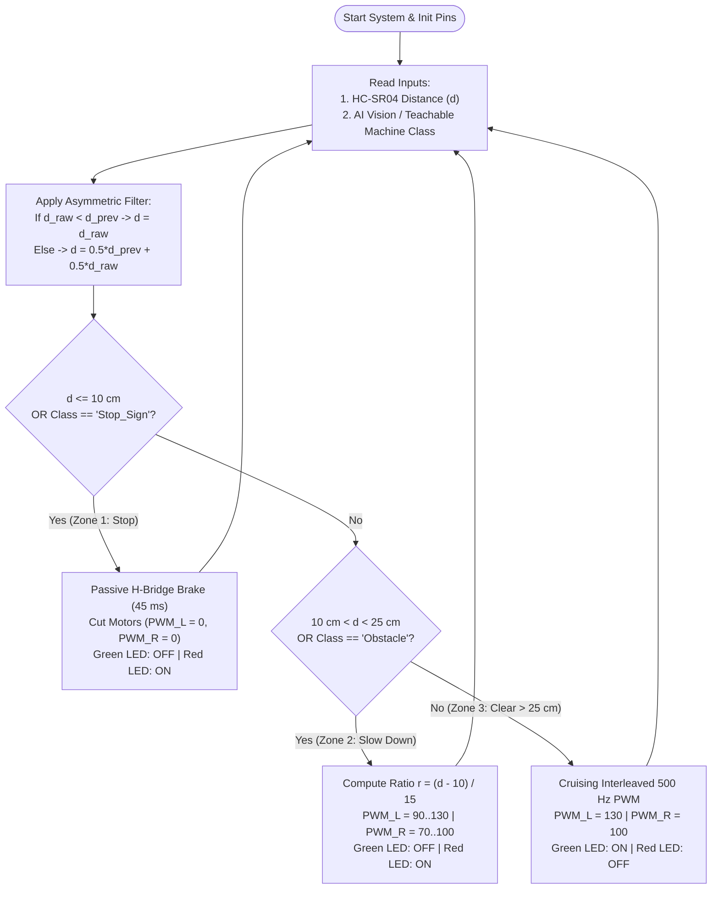

# 🚗 Autonomous Emergency Braking (AEB) 2WD Robot & AI Vision Studio

An open-source **2WD Autonomous Stopping Vehicle** built with **Arduino Uno R3, L298N Dual H-Bridge, HC-SR04 Ultrasonic Sensor, and Direct-Mounted Status LEDs**, paired with a standalone **Real-Time AI Vision & Teachable Machine Object Detection Studio** running directly in the browser.

---

## ✨ Key Features

### 1. Embedded Arduino Uno R3 Firmware (`Autonomous_Braking_Car_2WD.ino`)
* **500 Hz Phase-Interleaved PWM Control:** Alternates left (`ENA`) and right (`ENB`) motor pulses within each $2000\ \mu\text{s}$ cycle so only one motor draws peak current at any instant, cutting 2S 18650 battery voltage sag by **50%** and eliminating brown-out resets.
* **Independent Left/Right Gearbox Calibration:** Balanced duty limits ($PWM_L = 130$, $PWM_R = 100$) compensate for mechanical friction differences between left and right TT gear motors.
* **Asymmetric Ultrasonic ToF Filter:** Instantaneous response when approaching obstacles ($d_{\text{raw}} < d_{\text{prev}}$) with exponential smoothing when receding.
* **3-Zone Proportional Braking & Zero-Current H-Bridge Short Brake:**
  * **Zone 3 ($d > 25.0\text{ cm}$):** Steady cruising ($PWM = 130/100$), **Green LED ON**.
  * **Zone 2 ($10.0\text{ cm} < d \le 25.0\text{ cm}$):** Smooth linear deceleration ($PWM = 130 \to 90$ Left, $100 \to 70$ Right), **Red LED ON**.
  * **Zone 1 ($d \le 10.0\text{ cm}$):** $45\text{ ms}$ passive H-bridge electromagnetic short-brake ($0\text{ mA}$ battery draw) followed by complete motor cutoff, **Red LED ON**.

### 2. Standalone AI Vision & Teachable Machine Studio (`index.html`)
* **Zero-Install Browser Application:** Runs in Chrome/Edge using TensorFlow.js (`COCO-SSD` + Live KNN Feature Classifier + Google Teachable Machine model loader).
* **Real-Time Bounding Boxes & Vector Target Lines:** Draws object bounding boxes, 4 corner lock brackets, internal multi-point feature mesh lines, and dynamic distance/angle vector lines from the sensor origin.
* **In-App Live Training:** Hold-to-record sample collection across 3 customizable classes (`Clear_Road`, `Obstacle`, `Stop_Sign`) with live thumbnail previews and instant PNG report snapshot export.

---

## 🔌 Hardware Pin Mapping

| Subsystem | Module Terminal | Arduino Uno R3 Pin | Description |
| :--- | :--- | :--- | :--- |
| **Power (2S 18650)** | `+` ($7.4\text{ V}$) / `-` (`GND`) | L298N `12V` & `VIN` / `GND` | Main DC supply rail ($5\text{V-EN}$ bridged) |
| **L298N Driver** | `ENA`, `ENB` | `D5`, `D6` | Left & Right $500\text{ Hz}$ interleaved PWM |
| | `IN1`, `IN2` | `D7` (`LOW`), `D8` (`HIGH`) | Left TT motor forward direction & brake |
| | `IN3`, `IN4` | `D9` (`HIGH`), `D10` (`LOW`) | Right TT motor forward direction & brake |
| **HC-SR04 Sensor** | `VCC`, `GND`, `TRIG`, `ECHO` | `5V`, `GND`, `D11`, `D12` | Ultrasonic Time-of-Flight ranging |
| **Status LEDs** | Green (`+`/`-`), Red (`+`/`-`) | `D13`/`GND`, `D3`/`D2` (`LOW`) | Direct breadboard-free LED indicators |

---

## 🔄 Control Architecture Flowchart

---

## 🚀 Quick Start

1. **Run the AI Vision & Teachable Machine Studio:**
   * Open `index.html` in Google Chrome or Microsoft Edge (or double-click `Start_AI_Demo.bat` on Windows).
   * Grant webcam permission to view real-time bounding boxes, feature mesh lines, and train custom classes.
2. **Upload the Arduino Firmware:**
   * Open `Autonomous_Braking_Car_2WD.ino` in the Arduino IDE, select **Arduino Uno**, and click **Upload**.

---

## 📄 License
Distributed under the **MIT License**. Free to use, modify, and share for educational and research purposes.
